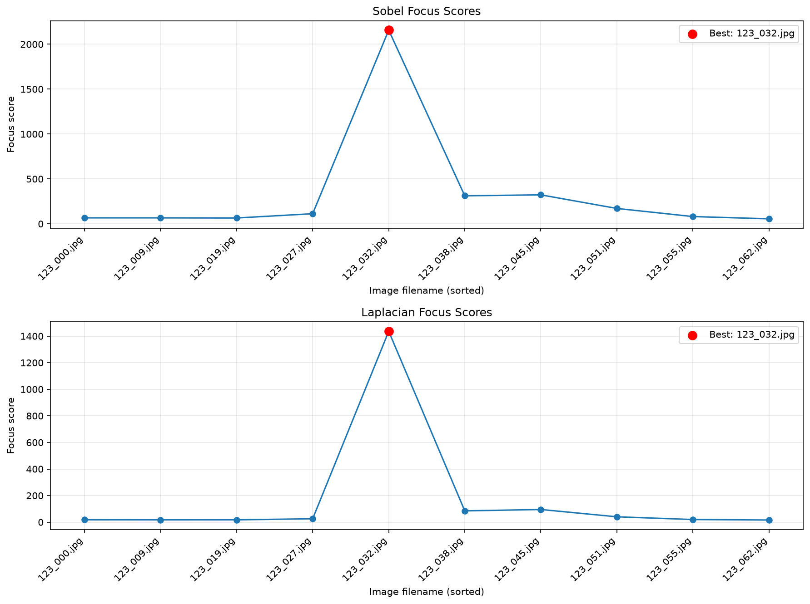

# 影像自動對焦作業

使用 Sobel 梯度能量與 Laplacian 變異數，
分析同一場景的不同對焦影像，選出清晰度最高的照片。

## 執行方式

1. 安裝 Python。
2. 安裝套件：

   ```bash
   python -m pip install -r requirements.txt
   ```

3. 在 main.py 同一層建立 images 資料夾，
   放入老師提供的 10 張照片。
4. 執行程式：

   ```bash
   python main.py
   ```

5. 結果儲存在 results 資料夾。

## 實驗結果

- 影像數量：10 張
- 解析度：1280 × 720
- Sobel 最佳照片：123_032.jpg
- Laplacian 最佳照片：123_032.jpg
- Sobel 平均處理時間：12.943 ms／張
- Laplacian 平均處理時間：5.748 ms／張

處理時間為每張照片重複量測 10 次取中位數，
再對 10 張照片取平均，不包含讀檔、灰階轉換及存檔。

## 清晰度曲線


